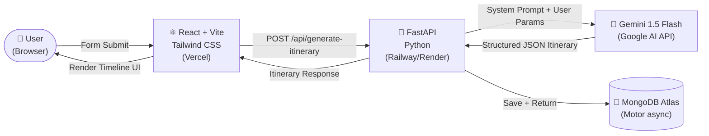

# Yatra AI — Karnataka Travel Planner
### 🏆 Hackathon Submission | Problem Statement 6

> *"An AI-powered travel planner that creates personalized Karnataka itineraries based on interests, available time, budget, and preferred type of experience."*

---

## 🗺️ Architecture Diagram



---

## ✨ Features

| Feature | Description |
|---|---|
| 🧠 **Hyper-Local AI** | Gemini 1.5 Flash with a 500-line Karnataka expert system prompt — knows actual road numbers, monsoon conditions, heritage site timings |
| 🗓️ **Day-by-Day Timeline** | Beautiful animated timeline with Morning / Afternoon / Evening breakdown per day |
| 🏍️ **Motorcycle Routes** | NH-75, SH-17, ghat sections, petrol station gaps — real biker intel |
| 🌧️ **Seasonal Intelligence** | Monsoon warnings for Coorg, Agumbe; beach recommendations for summer |
| 🍛 **Hidden Food Gems** | Non-tourist-trap restaurants: MTR, Shetty Lunch Home, Mitra Samaj, Vinayaka Mylari |
| 💾 **Itinerary History** | All generated itineraries saved to MongoDB, retrievable via API |
| 📄 **Print / PDF Export** | One-click browser print for offline use |
| 📱 **Fully Responsive** | Mobile-first design with Tailwind CSS |

---

## 🛠️ Tech Stack

| Layer | Technology |
|---|---|
| **Frontend** | React 18 + Vite + Tailwind CSS + Lucide Icons |
| **Backend** | FastAPI (Python 3.11+) + Uvicorn |
| **AI** | Google Gemini 1.5 Flash via `google-generativeai` SDK |
| **Database** | MongoDB Atlas + Motor (async driver) |
| **Deployment** | Vercel (Frontend) + Railway/Render (Backend) |

---

## 🚀 Local Setup

### Prerequisites
- Node.js 18+
- Python 3.11+
- MongoDB Atlas account (free tier works)
- Google AI Studio API key → [aistudio.google.com](https://aistudio.google.com)

---

### 1. Clone & Structure

```bash
git clone <your-repo>
cd kannada-hackathon
```

---

### 2. Backend Setup

```bash
cd backend

# Create virtual environment
python -m venv venv
venv\Scripts\activate        # Windows
# source venv/bin/activate   # Mac/Linux

# Install dependencies
pip install -r requirements.txt

# Configure environment
copy .env.example .env
# Edit .env — add your GEMINI_API_KEY and MONGODB_URI

# Run the server
uvicorn main:app --reload --port 8000
```

API docs available at → **http://localhost:8000/docs**

---

### 3. Frontend Setup

```bash
cd frontend

# Install dependencies
npm install

# Configure environment
copy .env.example .env
# VITE_API_BASE_URL=http://localhost:8000  ← already set

# Run dev server
npm run dev
```

App runs at → **http://localhost:5173**

---

## 📁 Project Structure

```
kannada-hackathon/
├── backend/
│   ├── main.py           # FastAPI app, routes, CORS
│   ├── ai_service.py     # Gemini integration + Karnataka system prompt
│   ├── models.py         # Pydantic request/response schemas
│   ├── database.py       # MongoDB Motor async connection
│   ├── requirements.txt
│   └── .env.example
│
├── frontend/
│   ├── src/
│   │   ├── App.jsx                        # Root component, hero, layout
│   │   ├── components/
│   │   │   ├── ItineraryForm.jsx          # Trip planner form
│   │   │   └── ItineraryResult.jsx        # Animated timeline results
│   │   ├── api/client.js                  # Axios API client
│   │   ├── index.css                      # Tailwind + custom styles
│   │   └── main.jsx                       # React entry point
│   ├── index.html
│   ├── vite.config.js
│   ├── tailwind.config.js
│   ├── package.json
│   └── .env.example
│
└── README.md
```

---

## 🌐 Deployment

### Frontend → Vercel
```bash
cd frontend
npm run build
# Push to GitHub → connect repo to Vercel
# Set env var: VITE_API_BASE_URL=https://your-backend.railway.app
```

### Backend → Railway
1. Push to GitHub
2. New project → Deploy from GitHub repo → select `backend/` folder
3. Set environment variables: `GEMINI_API_KEY`, `MONGODB_URI`, `ALLOWED_ORIGINS`
4. Start command: `uvicorn main:app --host 0.0.0.0 --port $PORT`

---

## 🔑 Environment Variables

### backend/.env
```env
GEMINI_API_KEY=your_gemini_api_key
MONGODB_URI=mongodb+srv://...
MONGODB_DB_NAME=karnataka_travel
ALLOWED_ORIGINS=http://localhost:5173,https://your-app.vercel.app
```

### frontend/.env
```env
VITE_API_BASE_URL=http://localhost:8000
```

---

## 📡 API Reference

| Method | Endpoint | Description |
|---|---|---|
| `GET` | `/` | Health ping |
| `GET` | `/health` | Detailed health check |
| `POST` | `/api/generate-itinerary` | Generate AI itinerary |
| `GET` | `/api/itineraries` | List saved itineraries |
| `GET` | `/api/itineraries/{id}` | Get itinerary by ID |

**POST `/api/generate-itinerary` body:**
```json
{
  "starting_point": "Bangalore",
  "days": 3,
  "budget": "mid-range",
  "interests": ["Heritage", "Wildlife"],
  "travel_style": "mixed"
}
```

---

## 👥 Team

Built with ❤️ for the **Kannada Hackathon** — Problem Statement 6: *AI Travel Planner for Karnataka*

---

*Performance Note: All heavy AI reasoning is offloaded to Gemini API. The backend is lightweight FastAPI — runs smoothly on 8GB RAM / i5 hardware.*
